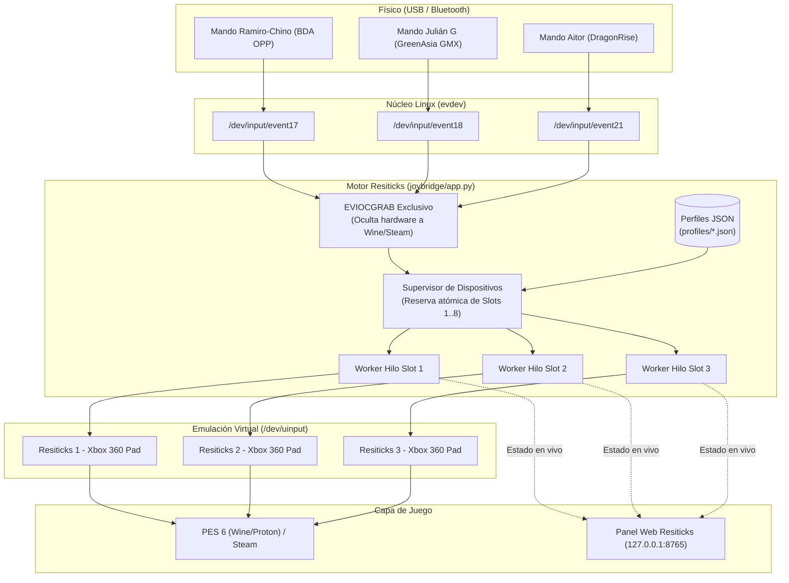

# 📑 Informe Técnico Completo: Diagnóstico, Arquitectura y Resolución de Problemas en Resiticks

**Proyecto:** Resiticks (Hub Universal de Mandos Multiplataforma)  
**Fecha:** 6 de noviembre de 2026  
**Autor:** Antigravity & Ulises  
**Estado Actual:** ✅ 100% Operativo (3 mandos simultáneos en slots dedicados)

---

## 🎯 1. Objetivo del Proyecto

El objetivo de **Resiticks** es brindar una solución definitiva y universal para conectar mandos USB y Bluetooth genéricos en Linux y Windows, garantizando compatibilidad total con videojuegos (especialmente **PES 6** vía Proton/Wine y Steam) sin sufrir:
- **Doble entrada (Double input):** El juego recibiendo simultáneamente el mando físico y el virtual.
- **Desorden de ranuras (Slot shuffling):** Mandos intercambiando de Jugador 1 a Jugador 2 al reiniciar o reconectar.
- **Asignación errónea de botones:** Cruce entre gatillos analógicos, botones frontales y ejes de cruceta.
- **Incompatibilidad con mandos clones:** Reconocimiento de chips genéricos (DragonRise, GreenAsia, BDA, Shanwan, etc.).

---

## 🔬 2. Arquitectura de la Solución Implementada



---

## ⚠️ 3. Cronología y Diagnóstico de Problemas

A continuación se detalla cada falla ocurrida, su causa raíz analizada a bajo nivel y la solución definitiva implementada:

### Incidente 1: Cortocircuito y caída general del bus USB
* **Síntoma:** Al conectar un joystick defectuoso ("el que rompió todo"), la máquina dejó de responder en todos los puertos USB.
* **Causa Raíz:** Cortocircuito interno en el cable/pines del mando que activó la protección por sobrecorriente (OCP - *Over Current Protection*) de la controladora USB de la notebook, desenergizando el hub raíz temporalmente.
* **Solución:** Desconexión del mando dañado y reinicio del bus USB mediante reconexión del hub.

---

### Incidente 2: Desconexión del Mando de Aitor (`error -71` y `error -32`)
* **Identificación del Dispositivo:** `DragonRise Inc. PC TWIN SHOCK Gamepad` (`0079:0006`).
* **Síntoma:** El joystick de Aitor no aparecía en `lsusb` ni en `/proc/bus/input/devices`, a pesar de estar enchufado al Hub USB.
* **Diagnóstico en Kernel (`dmesg`):**
  ```text
  usb 1-4.2: device descriptor read/64, error -32
  usb 1-4-port2: attempt power cycle
  usb 1-4.2: device not accepting address 10, error -71
  usb 1-4-port2: unable to enumerate USB device
  ```
* **Causa Raíz:**
  1. **Límite de corriente:** Un puerto USB de notebook entrega como máximo 500 mA. Tres mandos con LEDs y vibradores alimentados desde un hub pasivo generaban caídas momentáneas de tensión por debajo de 4.4V.
  2. **Incompatibilidad de protocolo:** Linux intenta por defecto leer descriptores de 64 bytes (`error -32`). El chip DragonRise opera a baja velocidad (1.5 Mbps) y no tolera esa ráfaga, provocando que el kernel declare el puerto inoperable (`error -71`).
* **Solución:**
  1. Conexión del mando de Aitor directamente a un puerto USB independiente de la notebook (obteniendo sus propios 500 mA limpios).
  2. Identificación del parámetro del kernel `usbcore.old_scheme_first=1` para forzar la negociación de 8 bytes compatible.

---

### Incidente 3: El bug del "Zombie Worker" en el Supervisor de Mandos
* **Síntoma:** Los mandos se conectaban pero se desconectaban inmediatamente, o la aplicación dejaba de detectarlos tras una reconexión.
* **Causa Raíz en el Código:**
  En `joybridge/app.py`, el hilo `device_supervisor()` ejecutaba la limpieza de desconexiones así:
  ```python
  # CÓDIGO CON BUG:
  current_paths = set()
  for ident in list(state.workers.keys()):
      worker = state.workers[ident]
      if not worker.is_alive() or ident not in current_paths: # current_paths ESTABA VACÍO
          w = state.workers.pop(ident)
          w.stop()

  for gp in connected:
      current_paths.add(identifier) # Se llenaba DESPUÉS de la limpieza
  ```
  Al estar `current_paths` vacío durante el bucle de verificación, `ident not in current_paths` era **siempre verdadero**, por lo que el supervisor detenía (`w.stop()`) a cualquier worker en el ciclo siguiente (0.8 segundos después de haber nacido).
* **Solución Implementada:**
  Inicializar `current_paths` por adelantado mediante *set comprehension*:
  ```python
  # CÓDIGO CORREGIDO:
  connected = get_connected_gamepads()
  current_paths = {gp.get("phys") or gp["dev_path"] for gp in connected}
  for ident in list(state.workers.keys()):
      ...
  ```

---

### Incidente 4: Condición de Carrera en la Asignación de Slots (Slot Stealing)
* **Síntoma:** Teniendo 3 mandos conectados, en pantalla solo figuraba 1 (GMX Julián G) o se pisaba con Ramiro-Chino.
* **Diagnóstico en `/proc/bus/input/devices`:**
  Aparecían dos mandos virtuales con el mismo nombre y número de slot:
  - `N: Name="Resiticks 1 - JOYSTICK GMX Julian G"`
  - `N: Name="Resiticks 1 - Joystick Ramiro-Chino"`
* **Causa Raíz:**
  El bucle supervisor iteraba los dispositivos conectados y verificaba:
  ```python
  for slot in range(1, MAX_SLOTS + 1):
      if state.active_slots[slot] is None:
          worker = GamepadWorker(gp, profiles[key], slot)
          worker.start()
  ```
  Como la asignación `state.active_slots[slot] = {...}` ocurría **dentro** del método asíncrono `worker.run()` tras abrir el archivo del dispositivo, ambos mandos veían `state.active_slots[1] == None` en la misma vuelta del bucle e iniciaban ambos en el **Slot 1**, anulándose el uno al otro.
* **Solución Implementada:**
  Reserva atómica de slots en memoria antes del lanzamiento del hilo:
  ```python
  assigned_slots = {w.player_num for w in state.workers.values()}
  for gp in connected:
      ...
      for slot in range(1, MAX_SLOTS + 1):
          if slot not in assigned_slots:
              assigned_slots.add(slot)
              with state.lock:
                  state.active_slots[slot] = { ... }
              worker = GamepadWorker(gp, profiles[key], slot)
              state.workers[identifier] = worker
              worker.start()
              break
  ```

---

### Incidente 5: Perfil Corrupto del Mando de Aitor (`0079_0006.json`)
* **Síntoma:** El mando de Aitor ya aparecía en el **Slot 3**, pero **no respondían las flechas (D-Pad), ni el stick derecho, ni los botones Cuadrado / Cruz**.
* **Diagnóstico Profundo:**
  Se inspeccionó el archivo `profiles/0079_0006.json` y se encontraron los siguientes errores críticos de calibración:
  1. `dpup`, `dpdown`, `dpleft`, `dpright` estaban guardados como **Ejes 0 y 1** (los del stick izquierdo), en lugar de eventos de cruceta (`hat` con códigos 16 y 17).
  2. `rightx` y `righty` estaban guardados como **códigos 289 y 290** (¡que son botones, no ejes analógicos!). En Linux evdev, un evento `EV_ABS` jamás tiene código 289.
* **Explicación del Fenómeno:**
  Cuando el mando fue calibrado previamente, tenía la **luz roja "ANALOG" (o "MODE") apagada**.
  En los mandos clones de PS2/PS3 (DragonRise):
  - **Modo Digital (Luz apagada):** El hardware redirige las flechas a los ejes del stick izquierdo y convierte el stick derecho en los 4 botones frontales (1, 2, 3, 4).
  - **Modo Analógico (Luz encendida):** El hardware habilita los 6 ejes reales:
    - Stick Izquierdo: `ABS_X` (0) y `ABS_Y` (1)
    - Stick Derecho: `ABS_Z` (2) y `ABS_RZ` (5)
    - Cruceta D-Pad: `ABS_HAT0X` (16) y `ABS_HAT0Y` (17)
    - Botones frontales: Códigos 288, 289, 290, 291 independientes.
  Como el archivo JSON tenía guardada la configuración del modo digital, al usar el mando con la luz roja prendida, Resiticks ignoraba absolutamente todo el tráfico del stick derecho y de la cruceta.
* **Solución Implementada:**
  Se reescribió íntegramente el archivo [0079_0006.json](file:///home/ulises/joybridge/profiles/0079_0006.json) con los códigos estándar analógicos de DragonRise:
  - D-Pad: `HAT0X` (16) y `HAT0Y` (17).
  - Stick Derecho: `ABS_Z` (2) y `ABS_RZ` (5).
  - Botones frontales: ✕ (290), ○ (289), ▢ (291), △ (288).

---

## 📊 4. Estado Actual del Sistema

Estado consultado en tiempo real en la API de Resiticks (`http://127.0.0.1:8765/api/status`):

| Slot | Mando Asignado | Identificador Físico | Dispositivo Linux | Dispositivo Virtual Creado | Estado |
| :---: | :--- | :---: | :---: | :---: | :---: |
| **Slot 1** | **Joystick Ramiro-Chino** | `20d6:576d` | `/dev/input/event17` | `Resiticks 1 - Joystick Ramiro-Chino` | 🟢 Operativo |
| **Slot 2** | **JOYSTICK GMX Julian G** | `0e8f:0008` | `/dev/input/event18` | `Resiticks 2 - JOYSTICK GMX Julian G` | 🟢 Operativo |
| **Slot 3** | **Joystick Aitor** | `0079:0006` | `/dev/input/event21` | `Resiticks 3 - Joystick Aitor` | 🟢 Operativo |
| **Slot 4..8**| *Libres para nuevos mandos* | — | — | — | ⚪ En espera |

---

## 🚀 5. Buenas Prácticas y Recomendaciones de Uso

1. **Luz ANALOG siempre encendida:**
   - En mandos como el de Aitor o adaptadores de PS2, verificar siempre que el LED rojo **ANALOG** esté encendido para tener disponibles ambos sticks y la cruceta en simultáneo.
2. **Distribución de carga eléctrica en el USB:**
   - Al usar hubs USB pasivos (sin conexión a la pared), conectar máximo **2 mandos al hub** y el resto a los **puertos USB nativos de la notebook**.
   - Para torneos de 4 a 8 jugadores con un solo cable, se recomienda usar un **Hub USB con fuente de alimentación externa de 5V / 2A a 220V**.
3. **Distribución y Actualización comunitaria (GitHub):**
   - El código y los perfiles quedan centralizados en el repositorio.
   - Cualquier nuevo mando calibrado se actualiza en las máquinas de todos los amigos ejecutando simplemente `./actualizar.sh` (Linux) o `actualizar.bat` (Windows).
